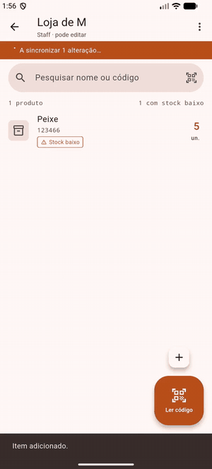

# Dja Konta?

**Inventário partilhado, sempre contado.**

<<<<<<< HEAD
App Android para gerir em equipa o stock de uma loja ou o equipamento de uma sala. Aponta a câmara ao código de barras, o produto aparece e atualizas a quantidade com um toque. Funciona mesmo sem rede.

*"Dja konta?" é crioulo cabo-verdiano para "Já contaste?"*
=======
Aplicação móvel para gerir inventários partilhados. O utilizador lê o código de barras de um produto com a câmara e vê ou altera a quantidade. As alterações chegam aos outros membros em tempo real e podem ser feitas sem rede.

O nome vem do crioulo cabo-verdiano: *Dja konta?* significa "Já contaste?".
>>>>>>> offline

<p align="center">
  
</p>

## Funcionalidades

<<<<<<< HEAD
- **Scanner** de códigos de barras e QR, com introdução manual se a câmara falhar
- **Ações rápidas** de +1 e −1 numa folha que abre logo depois do scan
- **Aviso de stock baixo** quando a quantidade fica abaixo do mínimo
- **Grupos partilhados** com papéis: staff edita, viewer só consulta
- **Convites** por código de 7 dias ou por QR
- **Modo offline**: as alterações ficam numa fila local e sincronizam quando a rede volta

## Como funciona o modo offline

A app guarda os grupos e os produtos numa cache em SQLite. Cada alteração feita sem rede entra numa fila de operações, também em SQLite.

Quando a ligação volta, detetada através do `.info/connected` do Firebase, um serviço de sincronização processa a fila pela ordem em que as alterações foram feitas:

- **+1 e −1** são enviados como incrementos e não como valores finais, por isso duas pessoas a mexer no mesmo produto ao mesmo tempo não se apagam uma à outra
- **criar e editar** verificam primeiro se o produto ainda existe no servidor

Antes de sair da conta, a app avisa se ainda há alterações por sincronizar.

## Tecnologias

| Camada | Tecnologia |
|---|---|
| App | Flutter, Dart |
| Autenticação | Firebase Authentication (email e password, com verificação de email) |
| Base de dados | Firebase Realtime Database, com regras de segurança por papel |
| Armazenamento local | SQLite (sqflite) |
| Scanner | Câmara do dispositivo |

## Correr localmente

Precisas do [Flutter](https://docs.flutter.dev/get-started/install) instalado e de um projeto Firebase teu.

```bash
git clone https://github.com/mimi0601022/dja_konta.git
cd dja_konta
flutter pub get
flutterfire configure
flutter run
```

## Contexto

Projeto desenvolvido na unidade curricular de Computação Móvel do Mestrado em Informática da ESTGD, Politécnico de Portalegre.

## Autora

**Miriam Pina** · [Portfólio](https://miriampina.vercel.app/) · [LinkedIn](https://linkedin.com/in/miriiampina)
=======
- Registo e login com email e palavra-passe, com verificação do email.
- Vários inventários (grupos) por utilizador, do tipo stock ou sala.
- Dois papéis por grupo: **staff**, que altera os itens e gere os membros, e **viewer**, que apenas consulta.
- Convites com código de seis caracteres, válidos durante sete dias, que podem ser escritos, lidos por QR ou partilhados.
- Leitura de códigos de barras e QR, com uma folha inferior de ações rápidas (+1, −1 e editar).
- Lista de itens em tempo real, com pesquisa e aviso de stock baixo.
- **Modo offline**, explicado abaixo.

## Como funciona o modo offline

A aplicação guarda os grupos e os itens numa cache em SQLite. Cada alteração feita sem rede entra numa fila de operações, também em SQLite.

Quando a ligação volta, detetada através do `.info/connected` do Firebase, o serviço de sincronização processa a fila pela ordem em que as alterações foram feitas:

- **+1 e −1** são enviados como incrementos e não como valores finais. Se dois dispositivos mexerem no mesmo item ao mesmo tempo, as alterações somam-se em vez de uma apagar a outra.
- **Criar e editar** verificam primeiro se o item ainda existe no servidor.

Uma faixa no topo do ecrã mostra quando há alterações por sincronizar.

## Tecnologias

- Flutter (Dart)
- Firebase Authentication
- Firebase Realtime Database, com regras de segurança
- sqflite (SQLite local)
- mobile_scanner, qr_flutter e share_plus

## Estrutura do código

```
lib/
  models/     classes dos dados (Grupo, Item, Membro, Convite)
  services/   lógica e acesso aos dados (autenticação, grupos, membros, itens, ligação, sincronização)
  screens/    ecrãs completos
  widgets/    componentes reutilizados (folha do item, folha do membro, faixa de sincronização)
  data/       base de dados SQLite
  utils/      validação de formulários e formatação de datas
```

## Como correr

Os ficheiros de configuração do Firebase não estão no repositório. Para correr a aplicação é preciso ter um projeto Firebase próprio.

1. Instalar o Flutter e a FlutterFire CLI.
2. Criar um projeto no Firebase e ativar o **Authentication** (email/palavra-passe) e o **Realtime Database**.
3. Na pasta do projeto, gerar a configuração:
   ```
   flutterfire configure
   ```
4. Publicar as regras do ficheiro `database.rules.json` no Realtime Database.
5. Instalar as dependências e correr:
   ```
   flutter pub get
   flutter run
   ```

## Contexto

Projeto da unidade curricular de Computação Móvel do Mestrado em Informática da ESTGD, Politécnico de Portalegre.

## Autora

**Miriam Pina**, 2026 · [Portfólio](https://miriampina.vercel.app/) · [LinkedIn](https://linkedin.com/in/miriiampina)
>>>>>>> offline
